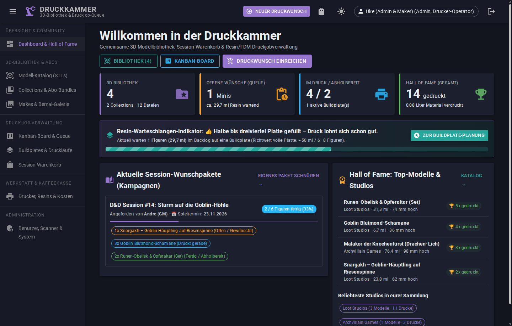
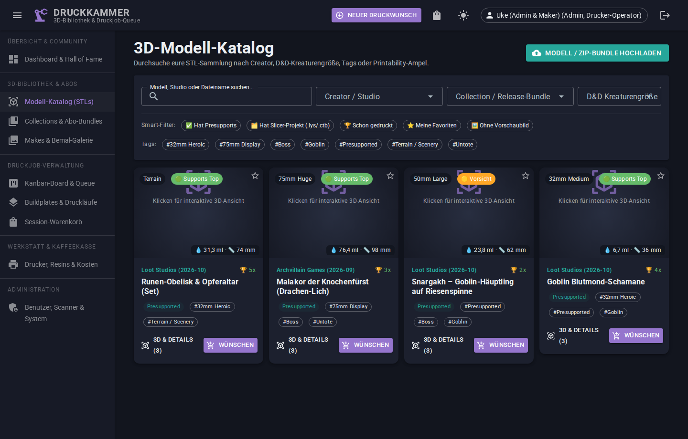
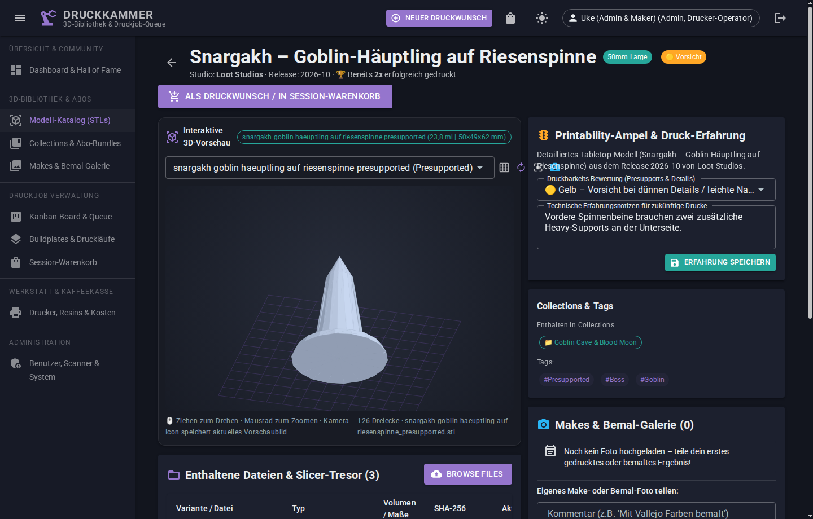
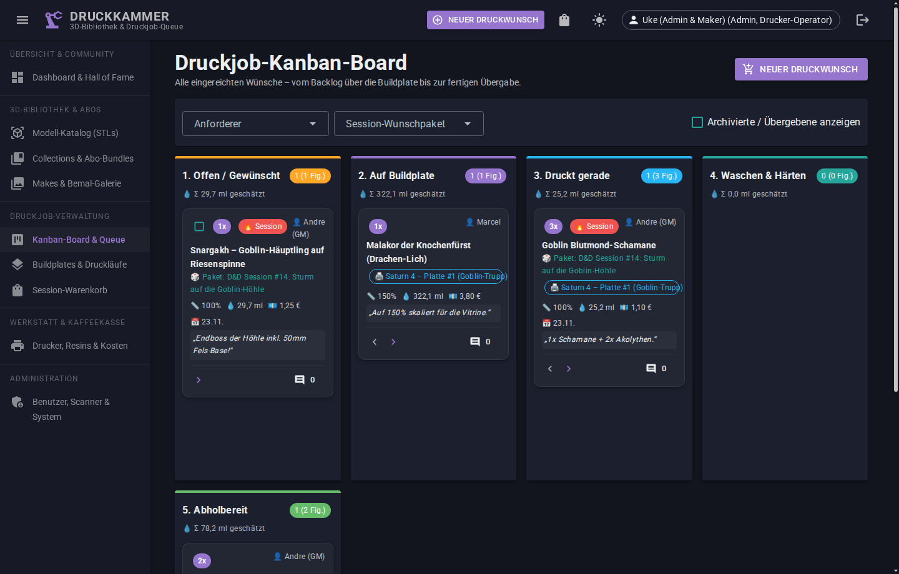
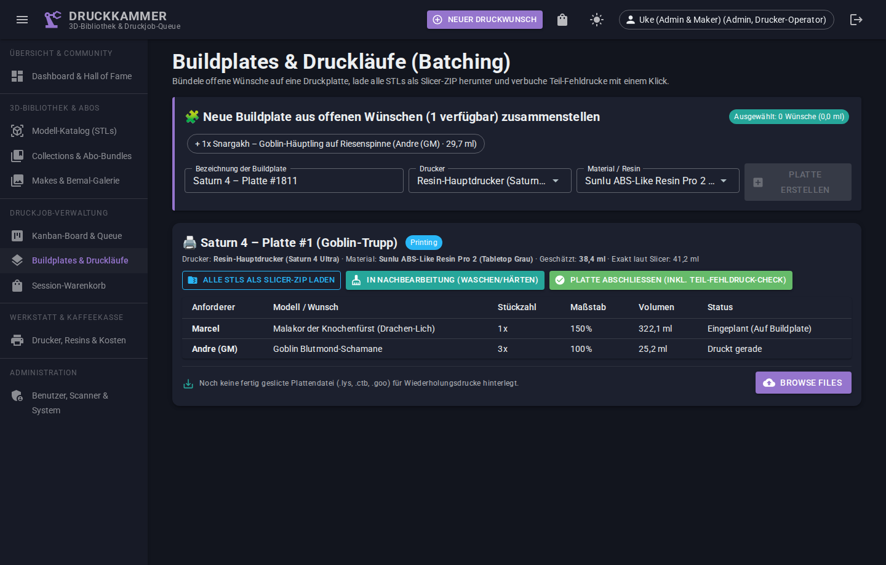
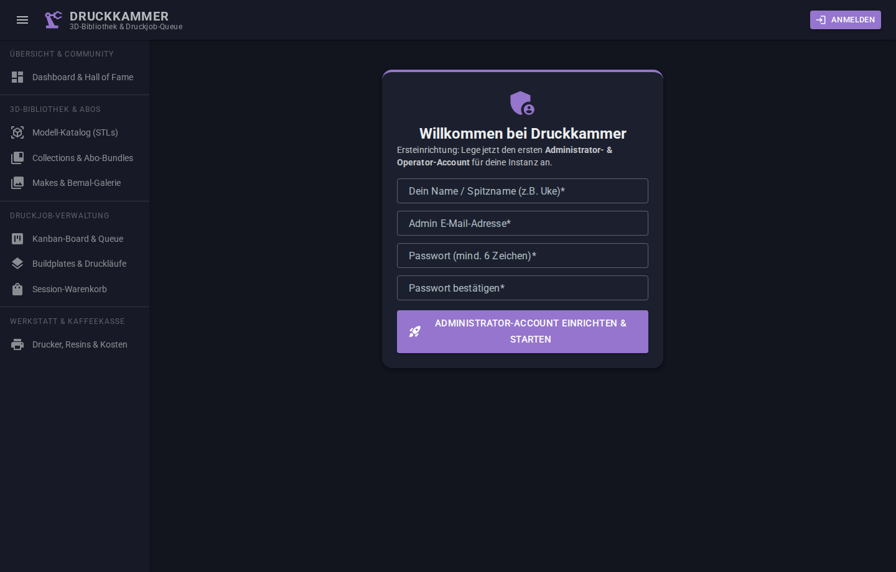

<p align="center">
  
</p>

# 🛠️ Druckkammer – 3D-Modellbibliothek & Druckjobverwaltung (.NET 11 Blazor)

**Druckkammer** ist eine selbstgehostete Multi-User-Webanwendung für 3D-Druck-Enthusiasten, Freundeskreise und Pen-&-Paper-/Tabletop-Runden. Sie verbindet eine verwaltete **3D-Modell-Bibliothek** (für große STL-/Abo-Sammlungen von Patreon, MyMiniFactory Tribes etc.) mit einem **Session-Warenkorb**, **Buildplate-Batching** und einem **Kanban-Board** für Resin- (SLA) und Filament-Druckjobs (FDM).

---

## 📸 Screenshots

### Dashboard, Resin-Warteschlangen-Füllstand & Hall of Fame


### 3D-Modell-Katalog mit D&D-Kreaturengrößen, Smart-Filtern & Printability-Ampel


### Modell-Detailansicht mit interaktivem 3D-STL-Viewer, Slicer-Tresor & Druck-Erfahrung


### Druckjob-Kanban-Board (Vom Wunsch über die Buildplate bis zur Übergabe)


### Buildplate-Batching, Slicer-ZIP-Export & Teil-Fehldruck-Recovery


### Ersteinrichtung des Administrator-Accounts beim ersten Start (`/setup`)


---

## ✨ Hauptfunktionen

### 1. Verwaltete 3D-Bibliothek & Copy-on-Import Speicher
- **Logische Modell-Einheiten**: Bündelt *Presupported STLs*, *Unsupported STLs*, *Bases*, *Slicer-Projektdateien* (`.lys`, `.ctb`, `.goo`, `.gcode`) und *Vorschaubilder* unter einem Modell.
- **Kanonischer App-Speicher & SHA-256 Deduplizierung**: Dateien aus Web-Uploads (Einzeldateien & `.zip`-Bundles) sowie aus dem **Verzeichnis-Scanner (`/import`)** werden zerstörungsfrei in den eigenen Speicher (`/data/storage/{Studio}/{Collection}/{Modell}/`) kopiert. Doppelte Dateien werden per SHA-256 Hash erkannt und nicht doppelt abgelegt.
- **Hierarchische Collections & Bundle-Poster**: Verschachtelbare Sammlungen für Creator-Releases (inkl. großem Monats-Poster im Kopfbereich) sowie für persönliche D&D-Kampagnenlisten.
- **Tabletop- & Smart-Filter**: Filterung nach D&D-Kreaturengrößen (`Tiny`, `Small/Medium 32mm`, `Large 50mm`, `Huge 75mm`, `Gargantuan 100mm+`, `Terrain`, `Büste`), Tags, *"Hat Presupports"*, *"Hat Slicer-Projekt"*, *"Schon gedruckt"* und persönlichen Favoriten.
- **Interaktiver 3D-Viewer & Auto-Thumbnail**: Direkt im Browser STLs drehen/zoomen, zwischen Varianten umschalten und per Klick (oder automatisch) ein Vorschaubild speichern.
- **Serverseitige STL-Analyse**: Automatische Berechnung des exakten Volumens in $\text{cm}^3$ ($\text{ml}$) und der Bounding-Box ($X \times Y \times Z$ in mm) für Binär- und ASCII-STLs.
- **Printability-Ampel, Erfahrungsnotizen & Makes-Galerie**: Ampelbewertung der Presupports (*Grün / Gelb / Rot*), technische Druckhinweise und Foto-Galerie für gedruckte & bemalte Figuren.

### 2. Session-Warenkorb, Maßstabs-Rechner & Kanban-Queue
- **Session-Warenkorb (`PrintOrder`)**: Game Master und Mitspieler können mehrere Figuren (oder eine ganze Collection) sammeln, mit einem gemeinsamen Kampagnentitel und Wunschtermin versehen und als Paket einreichen.
- **Integrierter Maßstabs-Umrechner**: Umrechnung zwischen Tabletop-Maßstäben (`28mm ↔ 32mm ↔ 54mm ↔ 75mm`) oder Eingabe einer exakten Zielhöhe in mm – das geschätzte Resin-Volumen skaliert automatisch kubisch ($s^3$) mit.
- **OpenGraph URL-Import**: Links von *MyMiniFactory*, *Printables* oder *Thingiverse* einfügen und Titel/Vorschaubild automatisch übernehmen.
- **Buildplate-Batching (`PrintBatch`) & Slicer-ZIP**: Mehrere offene Wünsche auf eine Druckplatte bündeln, gemeinsam durchs Kanban schieben und alle benötigten Druckdateien inkl. Checkliste als ZIP für den Slicer herunterladen.
- **Teil-Fehldruck-Recovery**: Sind auf einer Platte z.B. 6 von 8 Figuren gelungen, werden die 2 fehlgeschlagenen Exemplare beim Plattenabschluss automatisch als Nachdruck für die nächste Buildplate neu eingereiht.
- **Kaffeekasse & Hall of Fame**: Automatische Materialkostenschätzung pro User sowie Gemeinschafts-Statistiken.

### 3. Multi-User, Ersteinrichtung, OpenID Connect (SSO), TOTP 2FA & RBAC
- **Ersteinrichtung (`/setup`)**: Es gibt keine vorinstallierten Demo-Accounts. Beim allerersten Aufruf der Anwendung wird automatisch der Einrichtungsdialog für den ersten **Administrator- & Operator-Account** angezeigt.
- **Zwei-Faktor-Authentifizierung (TOTP 2FA)**: Jeder Benutzer kann unter `/account/security` eine Authenticator-App (Google Authenticator, Bitwarden, 1Password, Ente Auth, Authy) per QR-Code verknüpfen und erhält 8 Notfall-Recovery-Codes.
- **OpenID Connect (OIDC / Single Sign-On)**: Direkte Anbindung an Identity-Provider wie *Authentik*, *Keycloak*, *Pocket ID*, *Authelia*, *Google* oder *Microsoft Entra* (inkl. PKCE) – konfigurierbar über die Admin-Oberfläche (`/admin`) oder per Umgebungsvariablen.
- **Onboarding für Freunde/Mitspieler**: Registrierung per **Einladungs-Code (`InviteToken`)** oder mit Admin-Freischaltung.
- **Feingranulare Berechtigungen (`AppPermissions`)**: Standardrollen (`Admin`, `Drucker-Operator`, `Bibliotheks-Kurator`, `Anforderer`) mit live im Admin-Bereich anpassbarer Berechtigungs-Matrix.
- **Webhooks**: Benachrichtigungen über Discord, Telegram, generischen JSON-Webhook oder SMTP.

---

## 🚀 Start mit Docker Compose

```bash
docker compose up -d --build
```

Die Anwendung ist anschließend unter **`http://localhost:8080`** erreichbar und leitet beim ersten Start automatisch auf **`/setup`** zur Einrichtung deines Admin-Kontos weiter.

### Volumes
- `./data:/data` – Persistenter App-Speicher (SQLite-Datenbank `druckkammer.db`, kanonischer Modellspeicher `/data/storage`, Thumbnails & Makes).
- `./import:/import:ro` – Optionaler Read-Only Mount (z.B. NAS-Ordner mit bestehenden Patreon-Bundles), aus dem der Ordner-Scanner Modelle per Copy-on-Import übernimmt.

---

## 🧪 Lokale Entwicklung (.NET 11)

```bash
dotnet restore
dotnet test
dotnet run --project src/Druckkammer.Web
```
